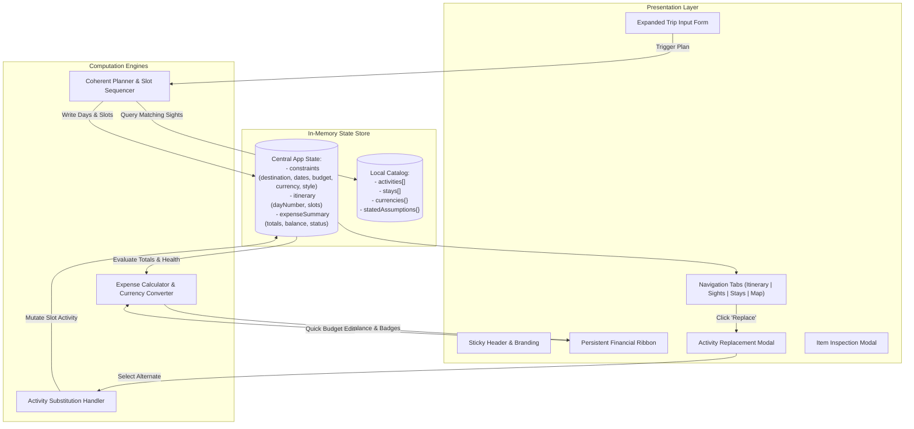

# waywise 🧭

> **Intelligent Day-Wise Trip Planner & Sights Explorer**  
> *Generate realistic, coherent itineraries, estimate expenses with transparent assumptions, and dynamically adapt when constraints change.*

[](https://opensource.org/licenses/MIT)
[](https://github.com/avinasharadya88/waywise)
[](http://localhost:3333/)

---

## 📖 Table of Contents
1. [Overview & Problem Statement](#-overview--problem-statement)
2. [Core Product Features](#-core-product-features)
3. [Architecture & Technical Design](#-architecture--technical-design)
4. [Step-by-Step User Guide](#-step-by-step-user-guide)
5. [Quick Start & Local Setup](#-quick-start--local-setup)
6. [Repository Structure](#-repository-structure)
7. [Contributing & Extending](#-contributing--extending)
8. [License](#-license)

---

## 🎯 Overview & Problem Statement

Planning a trip involves juggling multiple interdependent variables simultaneously—destinations, dates, fluctuating budgets, travel times, personal interests, and activity pacing. Travelers frequently suffer from:
* **Recommendation Overload**: Lengthy, unstructured lists of disconnected attractions that fail to translate into a realistic day-to-day schedule.
* **Financial Uncertainty**: Opaque cost estimates lacking baseline daily living expenses like meals and transit.
* **Rigid Itineraries**: Systems that break when a user wants to swap an activity or adjust their spending limits.

**waywise** solves this by providing a clean, single-page interactive interface that prioritizes **realistic coherence over raw quantity**, pairs activity fees with **clearly stated baseline assumptions**, and supports **instant, in-place recalculations** whenever trip constraints change.

---

## ✨ Core Product Features

### 1. Dynamic Trip Setup & Constraints
* **Multi-Destination Catalog**: Seamlessly plan for global hubs including **Paris, Tokyo, Bali, and Rome**.
* **Strict Date Ranges**: Date inputs formatted strictly in `YYYY-MM-DD` with automated total trip day calculations.
* **Multi-Currency Support**: Real-time conversion across 5 major currencies:
  * **USD ($)**
  * **INR (₹)**
  * **EUR (€)**
  * **GBP (£)**
  * **JPY (¥)**
* **Positive Budget Validation**: Strict input constraints ensuring positive numerical values.
* **Traveler Interests**: Multi-select tags covering *Culture & History*, *Food & Dining*, *Adventure & Outdoors*, and *Relaxation & Leisure*.
* **Pacing Preferences**:
  * **Relaxed**: Schedules 1–2 activities per day (Morning + Afternoon), leaving evenings open for spontaneous relaxation.
  * **Standard**: Balanced 3-slot schedule (Morning, Afternoon, Evening).
  * **Active**: Packed 3-slot schedule prioritizing high-energy and adventure activities.

### 2. Coherent Day-Wise Itinerary Generator
* Generates Day 1 through Day $N$ with structured, logical time slots:
  * **Morning**: Cultural landmarks, walking tours, and historic sights.
  * **Afternoon**: Museums, central experiences, culinary tours, and scenic walks.
  * **Evening**: Sunset viewpoints, dinners, and illuminated monuments.
* Prevents duplicate activities on the same journey.
* Assigns realistic durations and category tags to each slot.

### 3. Persistent Financial Ribbon & Stated Cost Assumptions
* **Transparent Formula**:
  $$\text{Total Cost} = \sum(\text{Activity Fees}) + (\text{Daily Meals} + \text{Daily Transit}) \times \text{Total Days}$$
* **Explicit Baseline Assumptions**:
  * Daily dining allowance: **\$40 / day** (converted to active currency).
  * Daily local transit allowance: **\$15 / day** (converted to active currency).
* **Live Budget Health Badge**:
  * Green Badge: `Within Budget (Remaining: $65)`
  * Red Warning Badge: `Over Budget by $45`
* **Quick-Budget Editor**: Modify your total budget directly from the persistent status bar to trigger immediate live recalculations without reloading the page.

### 4. Interactive In-Place Activity Replacement (Swap)
* Every scheduled activity card features a **"🔄 Replace"** button.
* Clicking "Replace" opens an overlay modal listing all compatible alternative activities for that locality and time slot.
* Surfaces exact real-time price differences (`+$10`, `-$5`, or `Same price`).
* 1-click selection swaps the activity into that exact day's slot and immediately updates the daily and total trip budget metrics.

### 5. Multi-View Navigation Bar
* 📅 **Day-Wise Itinerary**: The primary timeline view displaying structured slots and swap actions.
* 🏛️ **Things to Visit & Sights**: Curated catalog of must-see landmarks, food walks, viewpoints, and cultural experiences in that locality.
* 🏡 **Where to Stay**: Handpicked boutique lofts, traditional ryokans, and private pool villas.
* 🗺️ **Interactive Trip Map**: Geographical overview with clickable price pins and preview drawers.

---

## 🏗 Architecture & Technical Design

waywise is designed as a **deterministic, client-side Single-Page Application (SPA)** with zero external runtime dependencies, ensuring high developer velocity and offline reliability.



---

## 📘 Step-by-Step User Guide

Welcome to **waywise**! Follow this walkthrough to build, customize, and budget your ideal itinerary in under two minutes:

### Step 1: Set Your Core Trip Parameters
1. Open the application in your browser (`http://localhost:3333/`).
2. If the configuration panel is collapsed, click **"⚙️ Adjust Trip"** in the top-right or click the central compact search pill.
3. Select your target **Destination** (e.g., *Paris, France* or *Tokyo, Japan*).
4. Pick your **Start Date** and **End Date** using the calendar pickers. The system will automatically compute the total days.
5. Enter your **Total Budget** and choose your preferred **Currency** from the dropdown (`USD`, `INR`, `EUR`, `GBP`, `JPY`).

### Step 2: Choose Your Interests & Travel Style
1. Under **Interests**, toggle category tags on or off (*Culture & History*, *Food & Dining*, *Adventure*, *Relaxation*). Active tags will be highlighted.
2. Select your desired **Pacing Style**:
   * Choose **Relaxed** if you prefer a slow-paced morning and afternoon with an open evening for cafes and leisure.
   * Choose **Standard** for a balanced 3-slot daily schedule.
   * Choose **Active** for a full-throttle daily schedule featuring outdoor and high-energy experiences.
3. Click the gradient **"Generate Itinerary"** button.

### Step 3: Review Your Day-by-Day Schedule
1. In the **📅 Day-Wise Itinerary** tab, inspect each day of your trip.
2. Every day displays three distinct slots:
   * **Morning (☀️)**
   * **Afternoon (🌤️)**
   * **Evening (🌙)**
3. Review the photo, duration (`⏱️`), category, admission price, and description for each activity.

### Step 4: Monitor & Edit Your Budget in Real Time
1. Check the persistent **Financial Ribbon** below the header:
   * A **Green Badge** (`✓ Within Budget`) displays your remaining surplus funds.
   * A **Red Badge** (`⚠️ Over Budget by $X`) notifies you if scheduled items exceed your financial constraint.
2. Hover over the **💡 Stated Assumptions** tag to view the daily allowances included in your total ($40/day for meals, $15/day for transit).
3. To test budget changes on the fly, edit the numeric value in the **"Your Budget"** input box in the ribbon. Notice how the health badge immediately updates without any page reload!

### Step 5: Replace an Activity (In-Place Swapping)
1. Find any scheduled activity you wish to change (e.g., Day 1 Morning).
2. Click the **"🔄 Replace"** button on that slot's card.
3. The **Replace Activity** modal will appear, displaying all available alternative activities for that locality.
4. Each option shows the duration, category, and exact price difference relative to the current item (e.g., `-$10` or `+$15`).
5. Click **"Select"** on your preferred replacement. The modal will close, the slot will update, and all budget totals will automatically recalculate.

### Step 6: Explore Local Attractions & Places to Visit
1. Click the **🏛️ Things to Visit & Sights** tab in the navigation bar.
2. Browse through all curated experiences, historic landmarks, and food tours available in that locality.
3. Click any card to open a full modal containing high-resolution photos, detailed descriptions, operating highlights, and ratings.

### Step 7: Explore Handpicked Stays & The Interactive Map
1. Switch to the **🏡 Where to Stay** tab to review boutique apartments, private lofts, and villas in the area.
2. Switch to the **🗺️ Interactive Map** tab to see all activities pinned geographically with interactive price markers. Click any pin to open its preview drawer.

---

## 🚀 Quick Start & Local Setup

### Prerequisites
* **Node.js** (v18+) or **Python 3**
* A modern web browser (Chrome, Safari, Firefox, Edge)

### Installation & Run

1. **Clone the repository**:
   ```bash
   git clone https://github.com/avinasharadya88/waywise.git
   cd waywise
   ```

2. **Start the local server**:
   * *Using Node.js (Recommended)*:
     ```bash
     node server.js
     ```
   * *Using Python 3*:
     ```bash
     python3 -m http.server 3333
     ```

3. **Open the application**:
   Navigate to [http://localhost:3333/](http://localhost:3333/) in your web browser.

---

## 📁 Repository Structure

```
waywise/
├── PRD.md                  # Comprehensive Product Requirements Document
├── architecture.md         # Technical architecture & implementation blueprint
├── README.md               # Product overview, architecture, & user guide
├── index.html              # Single-page semantic HTML5 structure & modals
├── server.js               # Zero-dependency local Node.js static server
├── package.json            # Project manifest
├── .gitignore              # Git ignore rules
├── css/
│   └── airbnb.css          # Design system tokens, responsive grid & animations
└── js/
    ├── data.js             # Curated catalog of destinations, sights, stays & rates
    └── app.js              # State manager, generator, cost calculator & event handlers
```

---

## 🛠 Contributing & Extending

* **Adding New Destinations**: Open `js/data.js` and add a new entry to `PLANNER_DATA.destinations` alongside corresponding attractions in `PLANNER_DATA.activities`.
* **Adjusting Daily Assumptions**: Change `PLANNER_DATA.assumptions.dailyMealsCostUSD` or `dailyTransitCostUSD` in `js/data.js`.
* **Adding Currencies**: Add currency symbols and exchange rates to `PLANNER_DATA.currencies`.

---

## 📜 License

Distributed under the **MIT License**. See `LICENSE` for details.
