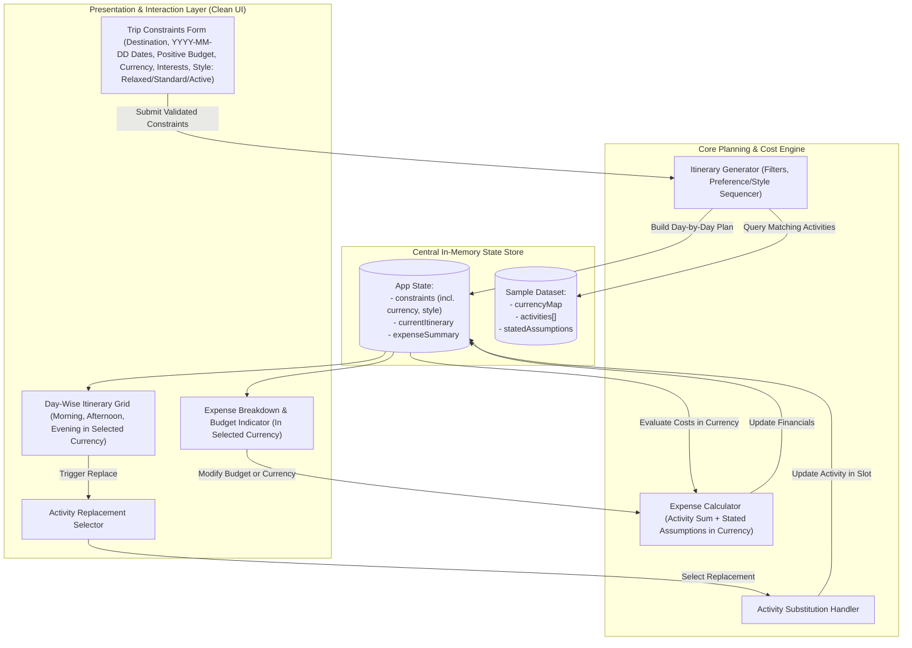

# System Architecture & Technical Specification

## Product Name
**waywise** (formerly Personal Trip Planner)

---

## 1. Architectural Overview & Design Goal
The goal is to provide the **simplest, most reliable architecture** that an engineer can implement and verify within **60 minutes**. 

To maximize developer velocity and eliminate external operational overhead:
* **Architecture Pattern**: Lightweight Client-Side Single-Page Application (SPA) or Minimal Single-Stack Application (e.g., Vanilla HTML/CSS/JavaScript, React, or Python Streamlit).
* **State Execution**: All planning logic, currency-formatted cost calculations, and substitutions execute deterministically in-memory using an embedded sample dataset.
* **Zero External Network Dependencies**: Operates 100% offline without third-party APIs, database provisioning, or external authentication.



---

## 2. Data Models, Schemas & Validation Contracts

### 2.1 Validation Rules (as specified in PRD)
* **`startDate` and `endDate`**: Must be valid ISO strings in strictly formatted `YYYY-MM-DD` format where `endDate >= startDate`.
* **`budget`**: Must be a positive number (`budget > 0`).
* **`interests`**: Must be a list of strings (`string[]`) with at least one item selected.
* **`travelStyle`**: Must be one of the three supported preferences: `Relaxed`, `Standard`, or `Active`.
* **`currency`**: Must be selected from supported currencies (e.g., `USD`, `INR`, `EUR`, `GBP`, `JPY`).

### 2.2 `TripConstraints`
Captures all user-defined parameters for itinerary creation.

```typescript
type TravelPreference = 'Relaxed' | 'Standard' | 'Active';

interface TripConstraints {
  destination: string;           // Target city/location (e.g., "Paris", "Tokyo")
  startDate: string;             // ISO Date format: YYYY-MM-DD
  endDate: string;               // ISO Date format: YYYY-MM-DD
  totalBudget: number;           // Positive number (> 0)
  currency: string;              // Selected currency code: 'USD' | 'INR' | 'EUR' | 'GBP' | 'JPY'
  interests: string[];           // List of strings: e.g., ['Culture', 'Food']
  travelStyle: TravelPreference; // 'Relaxed' | 'Standard' | 'Active'
}
```

### 2.3 `Activity`
Atomic unit of an experience within the catalog.

```typescript
interface Activity {
  id: string;                    // Unique identifier (e.g., "act-01")
  destination: string;           // Associated city
  title: string;                 // Descriptive name
  category: string;              // e.g., 'Culture', 'Food', 'Adventure', 'Relaxation'
  timeSlot: 'Morning' | 'Afternoon' | 'Evening'; // Best suited slot
  durationHours: number;         // Realistic duration (e.g., 2.5)
  cost: number;                  // Supplied price in currency units
  description: string;           // Brief summary
}
```

### 2.4 `DayPlan` and `ItineraryPlan`
Structured day-by-day itinerary schedule.

```typescript
interface DayPlan {
  dayNumber: number;             // Day 1, Day 2, etc.
  date: string;                  // Formatted Date (YYYY-MM-DD)
  slots: {
    morning?: Activity | null;
    afternoon?: Activity | null;
    evening?: Activity | null;
  };
  dailyActivityCost: number;     // Sum of activity costs for this day
}

interface ItineraryPlan {
  destination: string;
  totalDays: number;
  currency: string;
  days: DayPlan[];
}
```

### 2.5 `ExpenseSummary` & Stated Assumptions
Transparent financial calculation in the user's selected currency.

```typescript
interface StatedCostAssumptions {
  dailyMealsCost: number;        // Stated assumption for daily dining (e.g., 40 in base currency)
  dailyTransitCost: number;      // Stated assumption for local transport (e.g., 15 in base currency)
}

interface ExpenseSummary {
  currency: string;              // Selected currency code (e.g., "USD", "INR")
  currencySymbol: string;        // e.g., "$", "₹", "€", "£", "¥"
  totalActivityCost: number;     // Sum of all scheduled activities
  totalEstimatedMeals: number;   // dailyMealsCost * totalDays
  totalEstimatedTransit: number; // dailyTransitCost * totalDays
  totalEstimatedCost: number;    // activityCost + meals + transit
  userBudget: number;            // Current user-set budget
  balance: number;               // userBudget - totalEstimatedCost
  isOverBudget: boolean;         // True if balance < 0
  overageAmount: number;         // Math.max(0, -balance)
}
```

---

## 3. Built-In Sample Dataset & Currency Configuration
Engineers can embed this exact dataset directly into the code to ensure immediate, zero-setup execution.

```javascript
const SAMPLE_DATASET = {
  currencies: {
    USD: { symbol: "$", label: "USD ($)" },
    INR: { symbol: "₹", label: "INR (₹)" },
    EUR: { symbol: "€", label: "EUR (€)" },
    GBP: { symbol: "£", label: "GBP (£)" },
    JPY: { symbol: "¥", label: "JPY (¥)" }
  },
  assumptions: {
    dailyMealsCost: 40,
    dailyTransitCost: 15
  },
  destinations: ["Paris", "Tokyo"],
  activities: [
    // --- PARIS ACTIVITIES ---
    {
      id: "par-01",
      destination: "Paris",
      title: "Louvre Museum Guided Discovery",
      category: "Culture",
      timeSlot: "Morning",
      durationHours: 3,
      cost: 25,
      description: "Explore world-renowned historic art including the Mona Lisa."
    },
    {
      id: "par-02",
      destination: "Paris",
      title: "Latin Quarter Gourmet Pastry & Bakery Walk",
      category: "Food",
      timeSlot: "Morning",
      durationHours: 2,
      cost: 30,
      description: "Sample fresh baguettes, croissants, and artisan pastries."
    },
    {
      id: "par-03",
      destination: "Paris",
      title: "Montmartre & Sacré-Cœur Walking Tour",
      category: "Culture",
      timeSlot: "Afternoon",
      durationHours: 2.5,
      cost: 15,
      description: "Cobblestone streets, artists' squares, and panoramic city views."
    },
    {
      id: "par-04",
      destination: "Paris",
      title: "Seine River Electric Boat Cruise",
      category: "Relaxation",
      timeSlot: "Afternoon",
      durationHours: 1.5,
      cost: 20,
      description: "Gentle boat ride passing Notre Dame and the Eiffel Tower."
    },
    {
      id: "par-05",
      destination: "Paris",
      title: "Eiffel Tower Summit by Night",
      category: "Adventure",
      timeSlot: "Evening",
      durationHours: 2,
      cost: 35,
      description: "Panoramic nighttime view of the illuminated City of Light."
    },
    {
      id: "par-06",
      destination: "Paris",
      title: "Traditional Bistro Dinner & Wine Tasting",
      category: "Food",
      timeSlot: "Evening",
      durationHours: 2.5,
      cost: 50,
      description: "Authentic 3-course French dining experience in Le Marais."
    },
    {
      id: "par-07",
      destination: "Paris",
      title: "Tuileries Garden Leisure & Cafe Stroll",
      category: "Relaxation",
      timeSlot: "Morning",
      durationHours: 1.5,
      cost: 0,
      description: "Peaceful morning walk through French classical royal gardens."
    },
    {
      id: "par-08",
      destination: "Paris",
      title: "Musée d'Orsay Impressionist Masters",
      category: "Culture",
      timeSlot: "Afternoon",
      durationHours: 2,
      cost: 18,
      description: "Masterpieces by Monet, Van Gogh, and Renoir in a historic station."
    },
    {
      id: "par-09",
      destination: "Paris",
      title: "Moulin Rouge Cabaret & Music Show",
      category: "Culture",
      timeSlot: "Evening",
      durationHours: 2.5,
      cost: 65,
      description: "Historic Belle Époque theater performance."
    },

    // --- TOKYO ACTIVITIES ---
    {
      id: "tyo-01",
      destination: "Tokyo",
      title: "Senso-ji Temple & Asakusa Old Town",
      category: "Culture",
      timeSlot: "Morning",
      durationHours: 2.5,
      cost: 10,
      description: "Oldest Buddhist temple in Tokyo with historic stalls."
    },
    {
      id: "tyo-02",
      destination: "Tokyo",
      title: "Tsukiji Outer Market Sushi Tasting",
      category: "Food",
      timeSlot: "Morning",
      durationHours: 2,
      cost: 35,
      description: "Fresh sashimi, tamagoyaki, and street food delights."
    },
    {
      id: "tyo-03",
      destination: "Tokyo",
      title: "Meiji Jingu Shrine & Yoyogi Forest Walk",
      category: "Relaxation",
      timeSlot: "Morning",
      durationHours: 2,
      cost: 0,
      description: "Tranquil forest shrine oasis in the heart of Shibuya."
    },
    {
      id: "tyo-04",
      destination: "Tokyo",
      title: "Akihabara Tech & Arcade Exploration",
      category: "Adventure",
      timeSlot: "Afternoon",
      durationHours: 3,
      cost: 20,
      description: "Electric town immersion with retro games and electronics."
    },
    {
      id: "tyo-05",
      destination: "Tokyo",
      title: "Ramen Street Tasting Tour",
      category: "Food",
      timeSlot: "Afternoon",
      durationHours: 1.5,
      cost: 15,
      description: "Curated sampling of regional broth styles."
    },
    {
      id: "tyo-06",
      destination: "Tokyo",
      title: "Shibuya Sky Observation Deck",
      category: "Adventure",
      timeSlot: "Evening",
      durationHours: 1.5,
      cost: 22,
      description: "Rooftop panoramic view overlooking the Shibuya scramble."
    },
    {
      id: "tyo-07",
      destination: "Tokyo",
      title: "Shinjuku Omoide Yokocho Izakaya Dinner",
      category: "Food",
      timeSlot: "Evening",
      durationHours: 2,
      cost: 30,
      description: "Atmospheric alleyway dining with yakitori skewers and drinks."
    }
  ]
};
```

---

## 4. Core Algorithms & Logic Flow

### 4.1 Coherent Itinerary Generation Algorithm
The generator prioritizes **realistic coherence** (one activity per time slot, matched to preferences, no duplicate activities on the trip) and maps the three travel styles:
* **`Relaxed`**: 1–2 activities per day (Morning + Afternoon, Evening kept open for leisure).
* **`Standard`**: 2–3 activities per day (Morning + Afternoon + Evening, balanced pacing).
* **`Active`**: 3 full activities per day (Morning + Afternoon + Evening, prioritizes high-energy/adventure and outdoor activities).

```
FUNCTION validateInputs(constraints):
    IF constraints.destination IS EMPTY: RETURN "Destination required"
    IF NOT isValidDateFormat(constraints.startDate) OR NOT isValidDateFormat(constraints.endDate):
        RETURN "Dates must be in YYYY-MM-DD format"
    IF parseDate(constraints.endDate) < parseDate(constraints.startDate):
        RETURN "End date must be on or after start date"
    IF constraints.budget <= 0:
        RETURN "Budget must be a positive number"
    IF constraints.interests.length == 0:
        RETURN "At least one interest must be selected"
    IF constraints.travelStyle NOT IN ['Relaxed', 'Standard', 'Active']:
        RETURN "Invalid travel style"
    RETURN NULL // Valid

FUNCTION generateItinerary(constraints, catalog):
    validationError = validateInputs(constraints)
    IF validationError IS NOT NULL: THROW Error(validationError)

    totalDays = calculateDays(constraints.startDate, constraints.endDate)
    
    // Filter activities by destination and interests
    matchingActivities = catalog.activities.FILTER(
        act => act.destination == constraints.destination AND
               constraints.interests.CONTAINS(act.category)
    )
    
    // Fallback: if matching set is sparse, include other destination activities
    IF matchingActivities.length < totalDays * 2:
        matchingActivities = catalog.activities.FILTER(
            act => act.destination == constraints.destination
        )

    // Sort/prioritize for Active travel style if specified
    IF constraints.travelStyle == 'Active':
        matchingActivities.SORT((a, b) => (b.category == 'Adventure' ? 1 : 0) - (a.category == 'Adventure' ? 1 : 0))

    usedActivityIds = Set()
    days = []

    FOR dayIndex = 1 TO totalDays:
        dayDate = formatYYYYMMDD(addDays(constraints.startDate, dayIndex - 1))
        slots = { morning: null, afternoon: null, evening: null }

        // Determine target slots based on travelStyle:
        // 'Relaxed': Morning + Afternoon (Evening left open for leisure)
        // 'Standard' & 'Active': Morning + Afternoon + Evening
        targetSlots = (constraints.travelStyle == 'Relaxed') 
                      ? ['Morning', 'Afternoon'] 
                      : ['Morning', 'Afternoon', 'Evening']

        FOR slotName IN targetSlots:
            candidate = findBestActivity(matchingActivities, slotName, usedActivityIds)
            IF candidate IS NOT NULL:
                slots[slotName.toLowerCase()] = candidate
                usedActivityIds.ADD(candidate.id)

        dailyCost = SUM(slot.cost FOR slot IN slots.VALUES() IF slot != NULL)
        days.PUSH({ dayNumber: dayIndex, date: dayDate, slots, dailyActivityCost: dailyCost })

    RETURN { destination: constraints.destination, totalDays, currency: constraints.currency, days }
```

### 4.2 Dynamic Expense Calculation with Currency
Transparent calculations combining explicit activity fees with clearly stated baseline assumptions, presented in the selected currency:

$$\text{Total Activity Cost} = \sum_{d \in \text{Days}} \sum_{s \in \text{Slots}} \text{cost}(s)$$

$$\text{Total Stated Meals} = \text{dailyMealsCost} \times \text{totalDays}$$

$$\text{Total Stated Transit} = \text{dailyTransitCost} \times \text{totalDays}$$

$$\text{Total Estimated Cost} = \text{Total Activity Cost} + \text{Total Stated Meals} + \text{Total Stated Transit}$$

$$\text{Balance} = \text{Total Budget} - \text{Total Estimated Cost}$$

* If $\text{Balance} \ge 0$: Status is **"Within Budget"** (Formatted with Currency Symbol, e.g., `Within Budget: ₹5,000 remaining`).
* If $\text{Balance} < 0$: Status is **"Over Budget"** (Formatted with Currency Symbol, e.g., `Over Budget by $45`).

### 4.3 Activity Replacement Logic
Allows single-click swapping of scheduled activities:

```
FUNCTION getReplacements(destination, timeSlot, currentActivityId, catalog, activeItinerary):
    activeIds = getAllActiveActivityIds(activeItinerary)
    
    // Find all activities for the same destination and time slot not currently scheduled
    replacements = catalog.activities.FILTER(act => 
        act.destination == destination AND
        act.timeSlot == timeSlot AND
        act.id != currentActivityId AND
        NOT activeIds.CONTAINS(act.id)
    )
    RETURN replacements

FUNCTION replaceActivity(dayNumber, slotName, newActivity, state):
    day = state.itinerary.days.FIND(d => d.dayNumber == dayNumber)
    day.slots[slotName] = newActivity
    recalculateExpenses(state)
    renderViews(state)
```

---

## 5. User Interface (UI) Specification
Keep the UI clean, single-screen, and centered on the planning workflow:

1. **Top Header & Constraints Panel**:
   * **Destination**: Dropdown (Paris, Tokyo).
   * **Start Date & End Date**: Date pickers strictly formatted in `YYYY-MM-DD`.
   * **Currency Selector**: Dropdown provisioning currency options (`USD ($)`, `INR (₹)`, `EUR (€)`, `GBP (£)`, `JPY (¥)`).
   * **Total Budget**: Editable numeric input (validated for positive values $> 0$).
   * **Interests**: Multi-select checkboxes (`Culture`, `Food`, `Adventure`, `Relaxation`).
   * **Travel Preferences**: Segmented control or radio selector (`Relaxed`, `Standard`, `Active`).
   * **"Generate Itinerary"** button.

2. **Financial Status Bar (Persistent & Reactive)**:
   * Displays all figures in the selected currency (e.g., `₹`, `$`, `€`).
   * Total Estimated Cost vs. Budget with clear badge:
     * Green badge: *Within Budget (Remaining: {symbol}{balance})*
     * Red badge: *Over Budget by {symbol}{overage}*
   * Transparent assumption breakdown note: Activity total + Stated Daily Allowances ({symbol}40/day meals, {symbol}15/day transit).

3. **Day-Wise Itinerary Cards**:
   * Grouped by Day (e.g., "Day 1 - 2026-11-01").
   * 3 structured rows/cards per day:
     * **Morning Slot**: Title, category tag, duration, cost formatted in selected currency, and a **"Swap"** button.
     * **Afternoon Slot**: Title, category tag, duration, cost formatted in selected currency, and a **"Swap"** button.
     * **Evening Slot**: Title, category tag, duration, cost formatted in selected currency, and a **"Swap"** button (or "Free Time for Leisure" if `Relaxed` preference).

4. **Swap Modal / Dropdown**:
   * Appears when "Swap" is clicked.
   * Shows available alternates with price difference in selected currency (e.g., "+$5" or "-$10").
   * Selecting an alternate replaces the activity immediately, updates the card, and recalculates the budget.

---

## 6. 60-Minute Implementation Roadmap for Engineers

| Time Window | Focus Area | Deliverables |
| :--- | :--- | :--- |
| **00 – 15 Min** | **Data & Scaffold** | Set up `index.html`, style scaffolding, embed `SAMPLE_DATASET` with currency map, and initialize state. |
| **15 – 30 Min** | **Core Logic** | Implement input validation (`YYYY-MM-DD`, budget $>0$, style enum), `generateItinerary()`, `calculateExpenses()`, and `replaceActivity()`. |
| **30 – 50 Min** | **UI & Data Binding** | Render input form (including currency selector and `Relaxed`/`Standard`/`Active` options), day-wise timeline cards, dynamic expense banner, and swap modal. |
| **50 – 60 Min** | **Validation & Polish** | Verify: currency changes update display across all views; budget modification updates status; activity swap updates costs; input changes regenerate plan. |

---

## 7. Verification & Acceptance Testing Protocol
To ensure the prototype fulfills all updated PRD requirements:
1. **Test Case 1 (Generation & Currency Provisioning)**:
   * Select "Paris", Start Date "2026-11-01", End Date "2026-11-03" (`YYYY-MM-DD`), Budget `30000`, Currency `INR (₹)`, Interests `['Culture', 'Food']`, Style `Standard`.
   * Click Generate.
   * *Expected Result*: Generates 3 days with Morning, Afternoon, Evening slots filled. All costs, budget, and balance are formatted with `₹`.
2. **Test Case 2 (Travel Style Variations - Relaxed vs. Active)**:
   * Switch style to `Relaxed`: Evening slot becomes "Free Time for Leisure" and daily activity costs decrease.
   * Switch style to `Active`: Morning, Afternoon, and Evening slots are all filled, prioritizing active/adventure experiences.
3. **Test Case 3 (Input Validation Guarantees)**:
   * Attempt submit with negative budget (e.g. `-100`) or invalid date format: validation prevents submission and shows error message.
4. **Test Case 4 (Expense & Assumption Tracking in Currency)**:
   * Select Currency `USD ($)`, Budget `$300`, 3 days:
   * *Expected Result*: Budget bar displays total activity fees + (3 days $\times$ \$55 daily allowance = \$165). Balance indicates whether \$300 is exceeded with exact dollar amount.
5. **Test Case 5 (Activity Replacement & Real-Time Recalculation)**:
   * Click "Swap" on Day 1 Morning (e.g., swap Louvre for Bakery Walk).
   * *Expected Result*: Day 1 Morning updates to Bakery Walk. Total cost immediately reflects the price difference in the selected currency without page reload.
